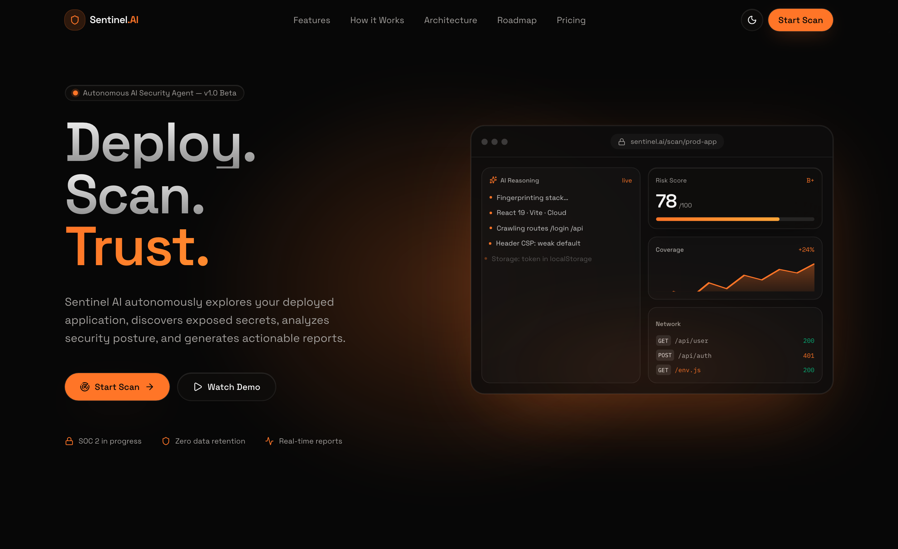
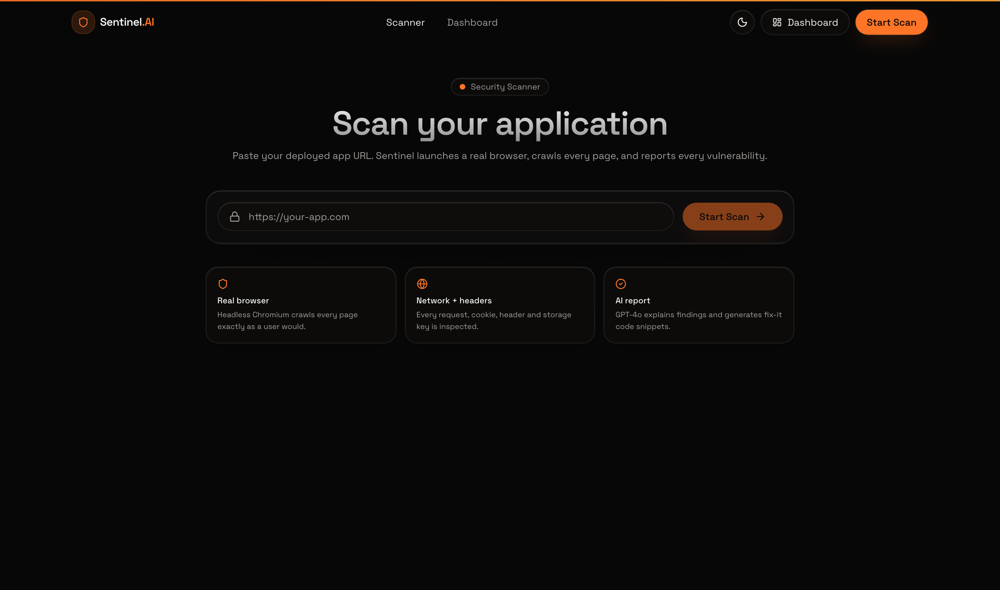
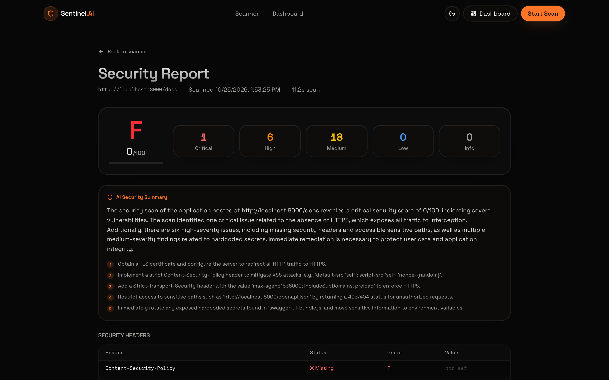
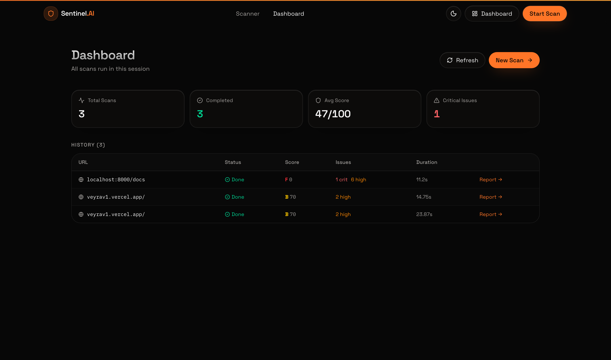

<div align="center">

  

  # Sentinel AI
  ### Autonomous Web Security Scanner & Vulnerability Verification Engine

  <p align="center">
    <strong>Sentinel AI operates like an elite security engineer inside your browser.</strong><br>
    It launches a headless Chromium browser, crawls your web application end-to-end, intercepts all network traffic, audits cookies & storage, detects exposed secrets in JavaScript bundles, and <strong>verifies every finding via real-time API calls</strong> before reporting.
  </p>

  <p align="center">
    <a href="#-quick-start">Quick Start</a> •
    <a href="#-key-features">Key Features</a> •
    <a href="#-architecture">Architecture</a> •
    <a href="#-visual-showcase">Visual Showcase</a> •
    <a href="#-api-reference">API Reference</a> •
    <a href="#-security-engine">Security Engine</a>
  </p>

  <p align="center">
    
    
    
    
    
    
    
  </p>

</div>

---

## 🌟 Visual Showcase

### 1. Modern Security Operations Center (Hero View)
A sleek, obsidian cyber interface built with Tailwind CSS v4, custom glassmorphism, and responsive micro-animations.

<div align="center">
  
</div>

<br>

### 2. Live Autonomous Scanner Terminal
Real-time Server-Sent Events (SSE) streaming browser events, page crawl progress, network request inspection, and bundle scans.

<div align="center">
  
</div>

<br>

### 3. Comprehensive Vulnerability Report
Detailed security score, posture grading (A+ to F), verified findings, categorized vulnerabilities, and AI-generated fix recommendations.

<div align="center">
  
</div>

<br>

### 4. Continuous Audit Dashboard
Centralized scan history tracking past posture scores, target domains, duration, and critical vulnerability metrics.

<div align="center">
  
</div>

---

## ⚡ Key Features

- **Autonomous Headless Browser Crawling**: Uses Playwright Chromium to load dynamic Single Page Applications (SPAs), execute clientside scripts, simulate user interaction, and discover all reachable routes.
- **Full Network & Storage Interception**: Monitors every outbound HTTP request, response headers, WebSocket frames, cookies (`HttpOnly`, `Secure`, `SameSite`), and `localStorage` / `sessionStorage` state.
- **Active Secret Verification Engine**: Unlike static scanners that report hundreds of harmless string patterns, Sentinel AI makes non-destructive live API probes to issuing services (AWS, GitHub, Stripe, OpenAI, Slack, Google Cloud, Supabase, SendGrid, etc.) to confirm whether leaked keys are active.
- **LLM False-Positive Pruning**: Any pattern that cannot be deterministically verified is passed to an AI reasoning judge (powered by OpenRouter) to evaluate token entropy, context, and issue high-confidence ratings.
- **Actionable Remediation**: Generates tailored executive summaries and drop-in code fixes for headers (CSP, HSTS, X-Frame-Options), cookie flags, and credential rotations.
- **Zero CORS / Live Streaming**: Built with TanStack Start SSR and FastAPI Server-Sent Events (SSE) for uninterrupted real-time scanning logs.

---

## 🏗 Architecture

```
┌─────────────────────────────────────────────────────────────────┐
│                    Frontend (React 19)                          │
│   TanStack Start (SSR) · TanStack Router · Zustand · Tailwind v4│
│   Landing · /scan (Live SSE) · /report/:id · /dashboard         │
└───────────────────────────────┬─────────────────────────────────┘
                                │ REST + Server-Sent Events (SSE)
┌───────────────────────────────▼─────────────────────────────────┐
│                     Backend (FastAPI)                           │
│                                                                 │
│   POST /api/scans            → Initialize background worker     │
│   GET  /api/scans/:id/stream → Real-time event streaming        │
│   GET  /api/scans/:id        → Security report & findings JSON  │
│   GET  /api/scans            → Historical scan metrics          │
└───────────────────────────────┬─────────────────────────────────┘
                                │ asyncio Task Manager
┌───────────────────────────────▼─────────────────────────────────┐
│               Scanner Engine (Playwright Chromium)              │
│                                                                 │
│   1. Launch headless sandbox browser session                    │
│   2. Crawl discovery tree & intercept all network requests      │
│   3. Download and parse complete JS bundle assets               │
│   4. Extract cookies, localStorage, and sessionStorage          │
│   5. Audit security headers (CSP, HSTS, Referrer-Policy, etc.)  │
└───────────────────────────────┬─────────────────────────────────┘
                                │ Extracted tokens & patterns
┌───────────────────────────────▼─────────────────────────────────┐
│               Secret Verification Pipeline                      │
│                                                                 │
│   Pattern Matching (85+ Security Signatures)                    │
│         │                                                       │
│         ├──[ Live API Verification Probe ]                      │
│         │     ├── Confirmed Active → Flagged as CRITICAL        │
│         │     └── Invalid / Revoked → Suppressed                │
│         │                                                       │
│         └──[ Unverifiable / Contextual Secrets ]                │
│               └── LLM Judge (OpenRouter / GPT-4o-mini)          │
│                     ├── False Positive → Suppressed             │
│                     └── Likely Exposed → HIGH Severity          │
└───────────────────────────────┬─────────────────────────────────┘
                                │
┌───────────────────────────────▼─────────────────────────────────┐
│                    Final Security Report                        │
│   Calculated Security Score · Grade · Prioritized Findings      │
│   Remediation Blueprints · Tech Stack Detection · PDF/JSON Export│
└─────────────────────────────────────────────────────────────────┘
```

---

## 🛡 Security Engine

Sentinel AI checks for vulnerabilities across 6 key attack surfaces:

| Category | What Sentinel AI Inspects |
| :--- | :--- |
| **API Keys & Secrets** | 85+ regex rules covering AWS, OpenAI, GitHub, Stripe, Supabase, SendGrid, GCP, Slack, and private keys with live verification. |
| **Security Headers** | Content-Security-Policy (CSP), Strict-Transport-Security (HSTS), X-Frame-Options, X-Content-Type-Options, Referrer-Policy, Permissions-Policy. |
| **Cookie Hardening** | `Secure` attribute, `HttpOnly` flag, `SameSite` configuration, session longevity, and cross-site exposure. |
| **Storage Hygiene** | Client-side exposure of JWTs, auth tokens, user credentials, or sensitive metadata in `localStorage` & `sessionStorage`. |
| **Network & Leakage** | Mixed HTTP/HTTPS content, sensitive queries in URLs, unencrypted data transfers, verbose server error responses. |
| **JavaScript Audit** | Source map disclosure, vulnerable third-party dependencies, inline event handlers, and exposed environment variables. |

---

## 🚀 Quick Start

### Prerequisites
- **Node.js** 20+ and **Bun** (or npm/pnpm)
- **Python** 3.11+
- An **[OpenRouter](https://openrouter.ai/)** API key (for the AI reporting and reasoning engine)

---

### 1. Clone the Repository

```bash
git clone https://github.com/AxAbhishek0309/SentinelAI.git
cd SentinelAI
```

### 2. Configure Backend

```bash
cd backend

# Install python dependencies
pip3 install -r requirements.txt

# Install Playwright Chromium headless binary
python3 -m playwright install chromium

# Configure environment
cp .env.example .env
```

Edit `backend/.env` with your OpenRouter key:
```env
OPENAI_API_KEY=sk-or-v1-your-openrouter-key
OPENAI_BASE_URL=https://openrouter.ai/api/v1
OPENAI_MODEL=openai/gpt-4o-mini
FRONTEND_ORIGIN=http://localhost:8080
MAX_SCAN_DURATION_SECONDS=120
MAX_PAGES_TO_CRAWL=10
```

Start the FastAPI server:
```bash
python3 -m uvicorn main:app --host 0.0.0.0 --port 8000 --reload
```
API runs at **`http://localhost:8000`** (Interactive Docs at **`http://localhost:8000/docs`**).

---

### 3. Configure Frontend

From the repository root:

```bash
# Install dependencies
bun install

# Start Vite dev server
bun run dev
```

Open **`http://localhost:8080`** in your browser.

---

## 🔌 API Reference

| Method | Endpoint | Description |
| :--- | :--- | :--- |
| `POST` | `/api/scans` | Start an autonomous scan: `{"url": "https://yourapp.com"}` |
| `GET` | `/api/scans` | List historical scans for the dashboard |
| `GET` | `/api/scans/{id}` | Retrieve scan progress, status, and completed vulnerability report |
| `GET` | `/api/scans/{id}/stream` | Server-Sent Events (SSE) live log stream for real-time UI updates |
| `DELETE` | `/api/scans/{id}` | Cancel an ongoing scan job |
| `GET` | `/api/health` | Backend and Playwright engine health check |

---

## 🛠 Tech Stack

- **Frontend**: [TanStack Start](https://tanstack.com/start), [React 19](https://react.dev/), [TanStack Router](https://tanstack.com/router), [Zustand](https://github.com/pmndrs/zustand), [Tailwind CSS v4](https://tailwindcss.com/)
- **UI & Icons**: [Radix UI](https://www.radix-ui.com/), [Lucide Icons](https://lucide.dev/), [Framer Motion](https://www.framer.com/motion/)
- **Backend Framework**: [FastAPI](https://fastapi.tiangolo.com/), [Uvicorn](https://www.uvicorn.org/), [Pydantic v2](https://docs.pydantic.dev/)
- **Automation Engine**: [Playwright Python](https://playwright.dev/python/) (Headless Chromium)
- **AI Reasoning**: [OpenRouter API](https://openrouter.ai/) (GPT-4o-mini, Claude, or custom LLM judges)

---

## 📄 License

This project is open-source and available under the [MIT License](LICENSE).

---

<div align="center">
  Made with precision by <a href="https://github.com/AxAbhishek0309"><strong>Abhishek Tiwari</strong></a>
</div>
